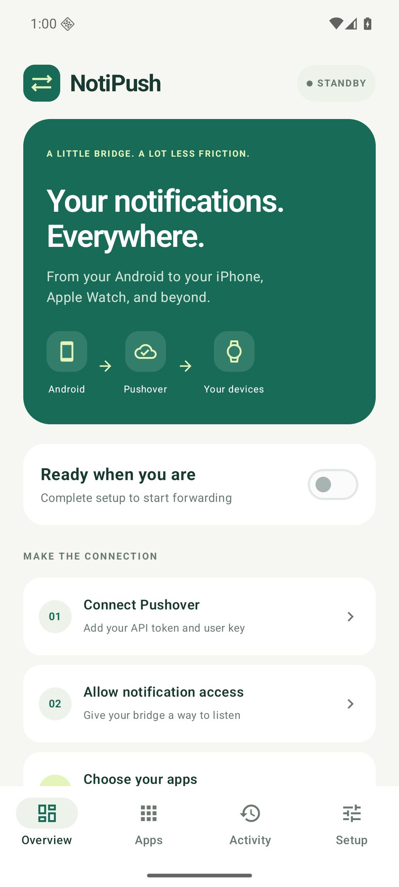
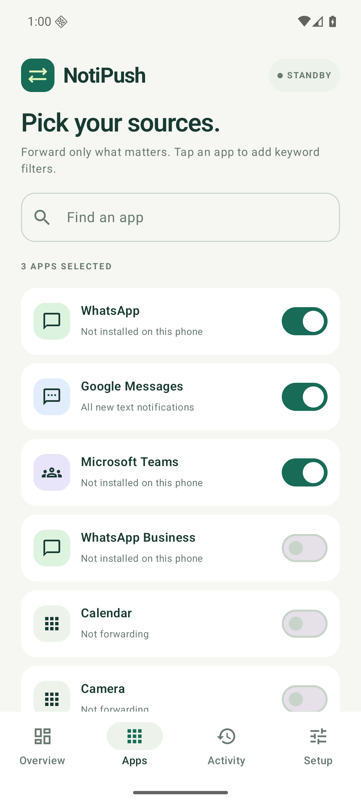
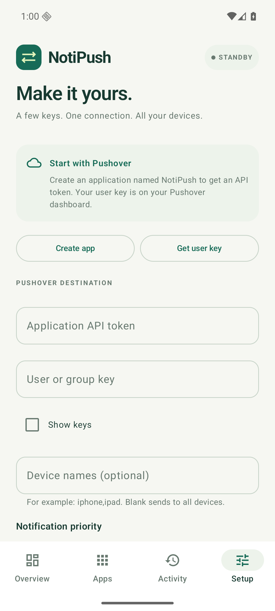

# NotiPush

**Your Android notifications, on your iPhone and Apple Watch.**

NotiPush forwards notifications from apps you choose to your own [Pushover](https://pushover.net/) account. It replaces the Android notification → Pushover workflow you might otherwise run through IFTTT, with no NotiPush subscription, credits, or hosted backend.

```text
WhatsApp · Google Messages · Teams · other selected apps
                         ↓
                 NotiPush on Android
                         ↓ HTTPS
                       Pushover
                         ↓
              iPhone · Apple Watch · other devices
```

**Android 16+ · Kotlin · Jetpack Compose · Current release: 1.0.2**

## Screenshots

| Overview | Choose apps | Pushover setup |
| :---: | :---: | :---: |
|  |  |  |

## Features

- Select individual apps. WhatsApp, Google Messages, and Microsoft Teams are preselected; WhatsApp Business and other installed launcher apps are available too.
- Forward the app name, conversation or sender, message text, and original timestamp.
- Filter each app by include/exclude keywords, ignoring case.
- Send to all your Pushover devices or a named device, with low, normal, or high priority.
- Suppress duplicate updates and group summaries; ignore ongoing notifications by default.
- Keep an encrypted offline queue and retry temporary network/server failures.
- See delivery status without retaining conversation text in completed history.
- Pause forwarding, send a test, or reset local configuration from the app.

## Requirements

- An Android phone running **Android 16 / API 36 or later**. The app targets Android 17 / API 37.
- A [Pushover account](https://pushover.net/) and your own application API token.
- The Pushover client installed and signed in on each receiving device.
- Notification access granted to NotiPush on Android.

NotiPush has no service fee. Pushover's client licensing and [message allowance](https://pushover.net/api#limits) still apply. NotiPush is an independent project and is not affiliated with IFTTT, Pushover, WhatsApp, Google, or Microsoft.

## Install

Use the signed APK attached to a published GitHub release, when available, or [build a release locally](#build-a-signed-release). This repository keeps generated APKs in the ignored `dist/` directory rather than in Git history.

Open the APK on your Android phone and allow installation from the source you chose when Android prompts. Updates must use the same signing key. Use **1.0.2 or newer**: 1.0.1 has a release-only startup crash fixed in 1.0.2.

## Connect Pushover

### 1. Get your two keys

1. [Register a Pushover application](https://pushover.net/apps/build) named **NotiPush**. Copy its **API Token/Key**.
2. Open your [Pushover dashboard](https://pushover.net/) and copy **Your User Key**.
3. Open **NotiPush → Setup** on Android and enter the following:

| NotiPush setting | Value |
| --- | --- |
| Application API token | The token from your **NotiPush application** in Pushover |
| User or group key | **Your User Key** from the Pushover dashboard |
| Device names | Leave blank for all devices; use the exact registered name, such as `iphone`, for one device |
| Notification priority | **Normal** to start |

Device names can be comma-separated, such as `iphone,ipad`. The API token identifies the sending application; the user key identifies the recipient account. They are different values.

Tap **Save destination → Send a test notification**. In **Activity**, **Accepted** means Pushover accepted the request; also confirm it arrived on the receiving device.

### 2. Enable Android forwarding

1. In **Setup**, grant **Notification access**. If Android restricts a sideloaded app, open its App info screen and use **Allow restricted settings** before enabling notification access. [Android's explanation](https://support.google.com/android/answer/12623953).
2. In **Apps**, choose the notification sources you want.
3. Tap an app to add optional keyword filters. Any include keyword can match; any exclude keyword blocks the notification. Leave both fields empty to forward all eligible text notifications from that app.
4. In **Overview**, turn forwarding on.
5. Receive a new message while its source app is in the background, so Android actually posts a notification.

If delivery stops while the phone sleeps, allow background activity and set NotiPush's battery use to **Unrestricted**. Some phone manufacturers also have an autostart setting. See [troubleshooting](docs/TROUBLESHOOTING.md).

### 3. Finish on iPhone and Apple Watch

- Sign into the same Pushover account on the iPhone and allow its notifications in iOS Settings.
- For Apple Watch, enable Pushover under **Watch → Notifications → Mirror iPhone Alerts From**.
- A separate watch device name is not required for iPhone notification mirroring. Alert routing depends on iPhone/Watch lock state, Focus settings, and notification preferences. See [Apple's guide](https://support.apple.com/108274) and [Pushover's Watch help](https://support.pushover.net/s1-pushover/knowledgebase/top/c5-iphone-ipad-apple-watch).

## Privacy and delivery behaviour

Credentials and pending message payloads are encrypted using AES-GCM with an Android Keystore key. App backup and device transfer are disabled. Completed history contains the source app, timestamp, and status, without notification titles or bodies. Screenshots and recent-app previews are protected in the production app.

Forwarded text is sent directly to Pushover over HTTPS. **This integration is not end-to-end encrypted with Pushover**: Pushover can process the forwarded content. There is no NotiPush server, analytics SDK, or advertising SDK.

| Behaviour | Limit |
| --- | --- |
| Pending queue | Up to 500 messages |
| Queue expiry | 24 hours; expired messages are not sent |
| Completed local history | Most recent 200 deliveries |
| Generic notification deduplication | Same notification key, title, and body for five minutes |
| MessagingStyle deduplication | Message fingerprints retained for 24 hours |
| Automatic retries | Network failures and HTTP 5xx, with exponential backoff |
| Permanent API rejections | HTTP 4xx, including quota/rate-limit rejection, are recorded as failed |

Pausing forwarding, disabling an app, or changing the destination cancels the corresponding queued messages. A request already in flight may still arrive. Failed payloads are erased and cannot be replayed from history. If a network response is lost after Pushover accepts a request, a retry can produce a duplicate.

### Platform limits

NotiPush reads **notifications**, not chat databases. It cannot forward a message that never produces a notification, read content Android redacts, or bypass work-profile policies. OTPs and other sensitive text may be hidden by Android. Attachments, reply actions, and dismissal synchronisation are not supported; attachment-only message notifications use a placeholder.

Android and manufacturer battery policies can delay background work. Force-stopping the app stops forwarding until you reopen it. Delivery is best effort and is not intended for emergency alerting. Old active notifications are not replayed when the listener reconnects.

## Build and test

Use **JDK 17 or 21**, **Android SDK Platform 37.0**, **Build Tools 37.0.0**, and **Python 3**. Open the project in a compatible Android Studio version, or set `ANDROID_HOME` to your SDK directory. Gradle 9.6.0 is downloaded through the checksum-pinned wrapper; AGP 9.4 provides built-in Kotlin support.

```sh
./gradlew :app:assembleDebug
./gradlew :app:testDebugUnitTest :app:lintDebug
python3 -m unittest discover -s scripts -p 'test_*.py'

# With a test device or emulator connected:
./gradlew :app:connectedDebugAndroidTest
```

The debug APK is written to `app/build/outputs/apk/debug/app-debug.apk`. Debug and release signing keys differ, so a debug build cannot update a separately signed release installation.

### Build a signed release

```sh
./scripts/build-release.sh
```

The script creates a local signing key once in `~/.local/share/notipush/signing/`, outside the repository, and reuses it for later updates. **Keep a secure backup of this directory.** Set `NOTIPUSH_SIGNING_DIR` to use a different private location. OpenSSL, `keytool`, and `shasum` must be available.

The output is `dist/NotiPush-1.0.2.apk` and `dist/SHA256SUMS`. Before copying the APK, the script verifies its v2/v3 signatures, production manifest, ZIP integrity, ARM64 support, 16 KB alignment, and the reflective constructors in the minified DEX.

Verify the installed **release** as well:

```sh
python3 scripts/smoke-release.py --serial YOUR_DEVICE --expected-version 1.0.2
```

This preserves app data, performs two cold starts, checks that each process survives for 15 seconds, verifies the main navigation, and checks for new crashes. Keep the app in the foreground during the check.

## Project structure

| Path | Purpose |
| --- | --- |
| `app/src/main/java/dev/notipush/` | Compose UI, notification listener, filtering, encrypted storage, and forwarding |
| `app/src/test/` | Filtering, extraction, queue, and mock Pushover API tests |
| `app/src/androidTest/` | Navigation and real Android Keystore checks |
| `scripts/build-release.sh` | Signed APK creation and validation |
| `scripts/verify-apk.py` | Packaging and minified-entry-point regression checks |
| `scripts/smoke-release.py` | Installed release startup checks |
| `scripts/diagnose-install.py` | Device installation diagnostics; read-only unless `--try-install` is passed |
| `docs/` | Troubleshooting, verification scope, and screenshots |

The GitHub Actions workflow is configured to build and test the project and check a minified release using a disposable CI signing key. CI does not publish APKs or use the private key for installed releases. See [contribution and release notes](CONTRIBUTING.md), [changelog](CHANGELOG.md), and [verification results](docs/VERIFICATION.md).
